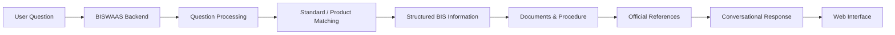

# BISWAAS

> AI-assisted web assistant that helps users discover relevant Bureau of Indian Standards information, including Indian Standard numbers, related standards, required documents, procedures, and official references through natural-language queries.

## VALKYRIES

* **Hackathon:** Smart India Hackathon 2026
* **Problem Statement ID:** SIH26107
* **Problem Statement Title:** Al-powered Intelligent Assistant for Indian Standards and BIS Services for Industries and Consumers
* **Theme:** Smart Automation | **Category:** Software
* **Team ID:** 147017
* **Institute:** Siliguri Institute of Technology, Siliguri, West Bengal

---

## Setup

BISWAAS is a Python-based Flask application consisting of a backend API and a conversational web interface.

### Prerequisites

* **Python:** Version 3.10 or newer
* **Git**
* **pip**

### Installation & Run Steps

1. **Clone the repository:**

   ```bash
   git clone https://github.com/ValkyriesProjects/VALKYRIES_BISwaas.git
   cd VALKYRIES_BISwaas
   ```

2. **Create and activate a Python virtual environment:**

   ```bash
   python3 -m venv .venv
   source .venv/bin/activate
   # Windows: .venv\Scripts\activate
   ```

3. **Install backend dependencies:**

   ```bash
   pip install -r backend/requirements.txt
   ```

4. **Start the Flask backend:**

   ```bash
   python backend/app.py
   ```

5. **Verify the backend:**

   Open:

   ```text
   http://127.0.0.1:5000/api/health
   ```

   A successful response confirms that the BISWAAS backend is running.

6. **Use the chat endpoint:**

   Send a `POST` request to:

   ```text
   /api/chat
   ```

   Example request:

   ```json
   {
     "message": "What are the BIS standards for an electric kettle?"
   }
   ```

---

## Overview

**BISWAAS** — *BIS Web Assistant for Authentication & Services* — is a conversational assistant designed to make information from the **Bureau of Indian Standards (BIS)** easier to discover and understand.

Finding the correct Indian Standard for a product or service can require users to navigate technical terminology, standard numbers, documentation requirements, certification information, and procedural details.

BISWAAS provides a natural-language interface where users can ask questions in ordinary language and receive structured information relevant to their query.

> *"Ask naturally. Find the right standard. Follow the right procedure."*

## Problem

BIS provides a large body of standards, certification information, product requirements, procedures, and supporting documentation. However, users may not always know the exact terminology or Indian Standard number associated with the product they are searching for.

A user asking:

> *"What BIS standard applies to an electric kettle?"*

should not have to know the standard number beforehand.

BISWAAS addresses this discovery problem by interpreting the user's question and returning relevant standard information together with supporting details and official references.

## How It Works



* **User Question:** Accepts a natural-language question about a BIS product, standard, certification, document, or procedure.
* **BISWAAS Backend:** Receives and validates the request through the Flask API.
* **Question Processing:** Processes the user's query and identifies the relevant information required to answer it.
* **Standard / Product Matching:** Connects the query with relevant Indian Standard numbers and associated product information.
* **Structured BIS Information:** Provides the identified standard and related standards where applicable.
* **Documents & Procedure:** Presents relevant documents and procedural information associated with the query.
* **Official References:** Provides official BIS references so users can verify the information from authoritative sources.
* **Conversational Response:** Converts the structured result into an understandable response.
* **Web Interface:** Presents the response through the BISWAAS conversational interface.

## Current Prototype

The current proof-of-concept demonstrates the end-to-end flow from a natural-language user query to a structured BIS-oriented response.

For example, a query regarding an **electric kettle** can return:

| Information                 | Prototype Output                               |
| --------------------------- | ---------------------------------------------- |
| **Primary Indian Standard** | IS 367:1993                                    |
| **Related Standard**        | IS 302-2-15:2009                               |
| **Documents**               | Relevant supporting/documentation requirements |
| **Procedure**               | Relevant procedural information                |
| **Official References**     | BIS / official reference links                 |

The prototype is designed so that the underlying data source can be replaced or expanded as the project develops without changing the overall conversational workflow.

## Usage

### 1. Start the Backend

From the repository root:

```bash
python backend/app.py
```

The Flask application starts the BISWAAS backend server.

### 2. Health Check

Send a `GET` request to:

```text
/api/health
```

A successful response indicates that the backend is operational.

### 3. Ask a BIS Question

Send a `POST` request to:

```text
/api/chat
```

Example:

```json
{
  "message": "What is the BIS standard for an electric kettle?"
}
```

The backend processes the question and returns a structured response containing relevant BIS information.

### 4. Conversational Interface

The frontend communicates with the Flask backend through the chat API.

The intended interaction is:

```text
User
  ↓
Natural-language BIS question
  ↓
BISWAAS
  ↓
Relevant Indian Standard
  ↓
Documents / Procedure / Related Standards
  ↓
Official References
```

## API

### `GET /api/health`

Checks whether the BISWAAS backend is running.

Example response:

```json
{
  "status": "success",
  "message": "Backend is healthy"
}
```

### `POST /api/chat`

Processes a natural-language BIS query.

Request:

```json
{
  "message": "What are the BIS standards for an electric kettle?"
}
```

The response contains the information identified by the BISWAAS processing layer, including relevant standards, supporting information, and official references.

## Repository Structure

```text
VALKYRIES_BISwaas/
├── backend/
│   ├── app.py                         # Flask application entry point
│   ├── requirements.txt               # Backend Python dependencies
│   ├── routes/
│   │   └── chat.py                    # Chat API routes
│   └── services/
│       └── chat_service.py            # BIS question processing logic
│
├── frontend/                          # Conversational web interface
│   └── ...
│
├── .gitignore
└── README.md
```

> The repository structure above should be synchronized with the final committed repository before publication if additional frontend, database, or configuration files are present.

## Technology Stack

* **Python** — Core backend programming language
* **Flask** — REST API and application server
* **Flask-CORS** — Cross-origin communication between frontend and backend
* **python-dotenv** — Environment configuration
* **HTML / CSS / JavaScript** — Conversational frontend
* **BIS Standards Data** — Domain-specific information layer
* **REST API** — Communication between the frontend and backend

## Data & Information Sources

BISWAAS is designed around authoritative BIS information and official references.

* **Bureau of Indian Standards (BIS):** Official source for Indian Standards, certification-related information, and BIS services.
* **Indian Standards:** Relevant IS numbers and associated product/technical information.
* **Official BIS References:** Links are provided where applicable so users can verify information directly from the official source.

> BISWAAS is intended to assist information discovery. Users should verify regulatory, certification, and compliance requirements against the latest official BIS documentation before taking formal action.

## Current Status

* **Completed:**

  * Flask backend setup.
  * REST API structure.
  * Health-check endpoint.
  * Natural-language chat endpoint.
  * Question-processing service.
  * Structured BIS response format.
  * Indian Standard identification for supported prototype queries.
  * Related-standard information.
  * Document information.
  * Procedure information.
  * Official reference information.
  * Frontend-to-backend API communication architecture.

* **In Progress:**

  * Expansion of BIS product and standard coverage.
  * Integration with the team's database/data layer.
  * Improvement of natural-language question processing.
  * Expansion of structured BIS information.

* **Planned (Future Expansion):**

  * Broader coverage of BIS standards and product categories.
  * More advanced natural-language understanding.
  * Dynamic retrieval from authoritative BIS information sources.
  * Improved document and procedure discovery.
  * More comprehensive official-reference mapping.
  * Enhanced conversational interaction.
  * Deployment as a scalable web service.

## Design Principles

* **Natural-Language First:** Users should be able to ask BIS-related questions without knowing the exact standard number beforehand.
* **Evidence-Oriented Responses:** Relevant standard numbers and supporting information should accompany answers wherever available.
* **Official References:** Users should be directed toward authoritative BIS sources for verification.
* **Modular Architecture:** Question processing, API routing, data handling, and frontend interaction are separated into logical components.
* **Extensible Data Layer:** The prototype is structured so that the initial data source can be replaced or expanded with a more comprehensive database.
* **No Unsupported Claims:** The assistant should distinguish available information from information that requires verification from official BIS documentation.

## Disclaimer

BISWAAS is an academic and research prototype developed by the **VALKYRIES** team for **Smart India Hackathon 2026**.

The information returned by the prototype is intended to assist users in discovering relevant BIS standards and services. It should not be treated as a substitute for the latest official BIS documentation, certification requirements, regulatory notifications, or professional compliance advice.

For formal certification, regulatory, or compliance decisions, users should verify the applicable requirements through official BIS sources.
